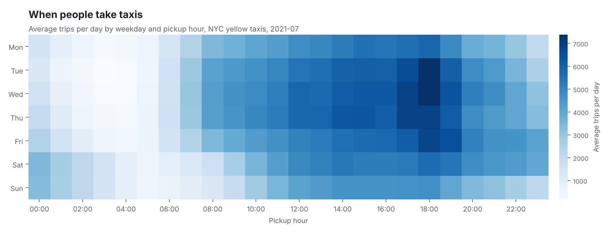

# NYC Taxi Trips: Data Quality and Demand Analysis with PySpark

[](https://colab.research.google.com/github/emmanuelkiprop448-sudo/nyc-taxi-pyspark-analysis/blob/main/notebooks/run_in_colab.ipynb)

A PySpark pipeline that takes one month of New York City yellow taxi trips (well over a million rows), checks every trip against data-quality rules, removes the trips that fail, and answers a set of business questions with Spark SQL. Each run produces CSV tables, charts and a written report.

## What it covers

- **Loading at scale.** Reads the official TLC Parquet files or CSV mirrors into Spark with one consistent schema.
- **Data-quality checks.** Seven explicit rules, each counted separately, so the report shows exactly how many trips each rule removed and why.
- **Spark SQL analysis.** Demand by weekday and hour, pickup boroughs and zones, airport trips, payment mix and tipping.
- **Reporting.** Charts and a markdown report generated from the results, with no numbers typed by hand.
- **Tests.** Unit tests for the data-quality rules using a small Spark DataFrame.

## Results

Latest run: **July 2021**, 2.82 million raw trips. [Full report](output/2021-07/report.md)

- 2,690,027 trips (95.3%) passed all seven data-quality rules; 131,488 were removed.
- The busiest slot was Wednesday 18:00, averaging 7,381 trips per day; the quietest was Tuesday 03:00, with 180.
- 72.6% of trips were paid by card, and the median card tip stayed between 25.6% and 27.7% of the fare across the day.



Each run writes to `output/<month>/`:

| File | Contents |
| --- | --- |
| `report.md` | Headline figures, data-quality table, findings and charts |
| `charts/*.png` | Demand heatmap, top pickup zones, median tip by hour |
| `tables/*.csv` | Every query result, for further analysis |

## Data-quality rules

| Rule | A trip fails when |
| --- | --- |
| `missing_timestamp` | The pickup or drop-off time is missing |
| `outside_month` | The pickup falls outside the month being analysed |
| `bad_duration` | The trip lasts under 1 minute or over 3 hours, or ends before it starts |
| `bad_distance` | The distance is zero, negative, missing or over 100 miles |
| `bad_fare` | The fare is zero or negative (refunds and voids), missing, or over $1,000 |
| `bad_passengers` | The passenger count is 0 or more than 6 (a missing count is kept) |
| `implausible_speed` | The average speed is over 80 mph |

A trip can fail several rules, so the per-rule counts can add up to more than the trips removed.

Two details matter for the analysis:

- **Tips** are only recorded for card payments, so tip figures use credit-card trips alone.
- **Demand** is shown as average trips per day for each weekday and hour, so a weekday that occurs five times in a month is not over-counted.

## How to run

**In the browser:** open the notebook with the "Open in Colab" button above and run the cells. Google Colab installs everything, downloads the month you choose and shows the report. Nothing is needed on your computer.

**On your computer:** you need Python 3.10 or later and Java 17 or 21 (Spark runs on Java).

```bash
python -m venv .venv
source .venv/bin/activate          # Windows: .venv\Scripts\activate
pip install -r requirements.txt

python scripts/download_data.py --month 2025-06     # official TLC Parquet file
python -m taxi_analysis.run --month 2025-06
pytest
```

`--source mirror` downloads CSV files from the DataTalksClub GitHub mirror instead, which covers January 2019 to July 2021.

On Windows, if Spark fails to start or complains about Hadoop or `winutils`, run the project inside WSL or Google Colab instead.

## Project structure

```
scripts/download_data.py    downloads trips and the taxi zone lookup into data/raw/
taxi_analysis/load.py       Spark session, reading and type casting
taxi_analysis/quality.py    data-quality rules, flags and summary counts
taxi_analysis/analysis.py   derived columns and the Spark SQL queries
taxi_analysis/charts.py     matplotlib charts
taxi_analysis/run.py        runs the whole pipeline for one month
tests/test_quality.py       unit tests for the rules
```

## Data source

Trip records and the taxi zone lookup are published by the [NYC Taxi & Limousine Commission](https://www.nyc.gov/site/tlc/about/tlc-trip-record-data.page).
