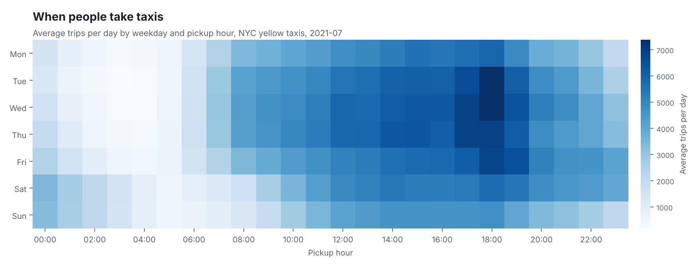
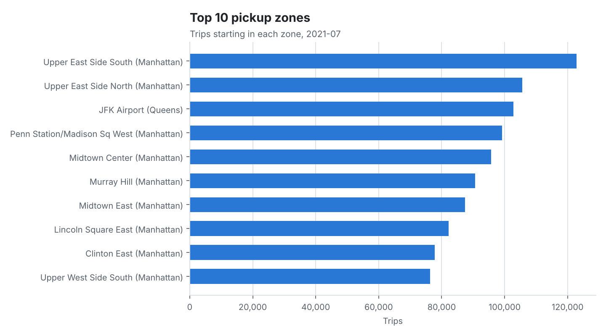
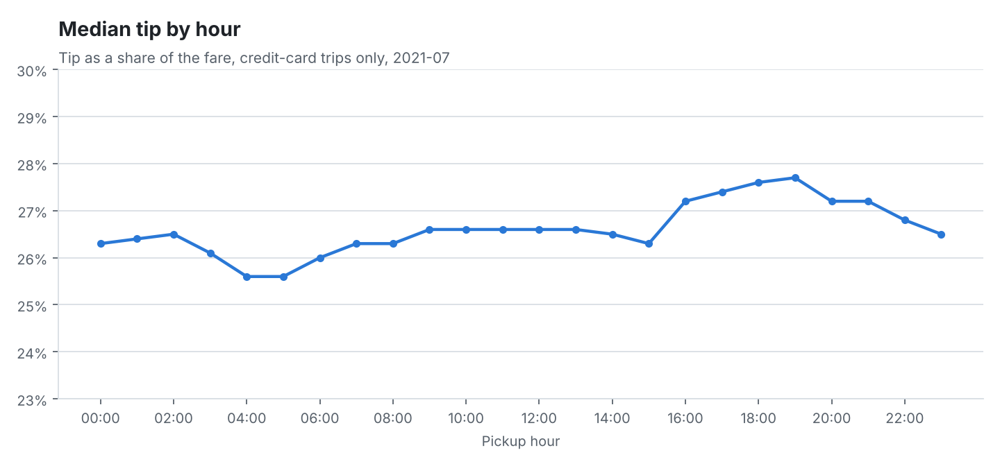

# NYC yellow taxi trips, 2021-07

Source file: `yellow_tripdata_2021-07.csv.gz`. Generated by `python -m taxi_analysis.run --month 2021-07` in 38 seconds.

## Headline

- **2,821,515** raw trips; **2,690,027** kept after data-quality checks (95.3%), **131,488** removed.
- Average fare **$13.63**, average distance **3.38 mi**, median trip **11.0 min**.
- **72.6%** of trips were paid by credit card.
- Busiest slot: **Wed 18:00** (7,381 trips per day on average). Quietest: **Tue 03:00** (180).
- Median card tip peaks at **27.7%** of the fare at 19:00 and is lowest at **25.6%** at 04:00.

## Data quality

Each rule is checked on every raw trip; a trip can fail more than one rule, so the counts can add up to more than the trips removed.

| Rule | Trips caught | % of raw trips |
| --- | --- | --- |
| Pickup or drop-off time is missing | 0 | 0 |
| Pickup is outside 2021-07 | 130 | <0.01 |
| Trip lasts under 1 minute or over 3 hours (or ends before it starts) | 40,878 | 1.45 |
| Distance is zero, negative, missing or over 100 miles | 37,622 | 1.33 |
| Fare is zero, negative (refunds and voids), missing or over $1,000 | 14,525 | 0.51 |
| Passenger count is 0 or more than 6 (missing counts are kept) | 66,766 | 2.37 |
| Average speed is over 80 mph | 4,916 | 0.17 |

## Demand by weekday and hour

## Pickup boroughs

| pickup_borough | trips | share_pct | fare_per_mile_usd | median_duration_min |
| --- | --- | --- | --- | --- |
| Manhattan | 2,435,869 | 90.6 | 4.46 | 10.3 |
| Queens | 195,349 | 7.3 | 3.01 | 29.7 |
| Brooklyn | 27,655 | 1 | 3.68 | 22.2 |
| Unknown | 22,803 | 0.8 | 3.98 | 19.9 |
| Bronx | 8,100 | 0.3 | 3.58 | 25.1 |
| Staten Island | 225 | 0 | 2.86 | 50 |
| EWR | 26 | 0 | 4.49 | 29.8 |

## Top pickup zones

| borough | zone | trips | avg_fare_usd | avg_distance_mi |
| --- | --- | --- | --- | --- |
| Manhattan | Upper East Side South | 122,843 | 9.43 | 1.93 |
| Manhattan | Upper East Side North | 105,533 | 10.09 | 2.17 |
| Queens | JFK Airport | 102,853 | 45.8 | 15.93 |
| Manhattan | Penn Station/Madison Sq West | 99,205 | 11.67 | 2.5 |
| Manhattan | Midtown Center | 95,729 | 10.57 | 2.21 |
| Manhattan | Murray Hill | 90,691 | 10.87 | 2.35 |
| Manhattan | Midtown East | 87,387 | 10.62 | 2.31 |
| Manhattan | Lincoln Square East | 82,162 | 10.44 | 2.29 |
| Manhattan | Clinton East | 77,854 | 11.45 | 2.6 |
| Manhattan | Upper West Side South | 76,348 | 10.83 | 2.43 |

## Airport trips

Trips that start or end at JFK, LaGuardia or Newark.

| airport | trips | avg_fare_usd | avg_total_usd | avg_distance_mi |
| --- | --- | --- | --- | --- |
| JFK Airport | 121,239 | 46.77 | 60.47 | 16.2 |
| LaGuardia Airport | 86,225 | 30.6 | 43.95 | 9.8 |
| Newark Airport | 4,890 | 69.19 | 97.38 | 17.2 |

## Payments and tips

| payment | trips | share_pct |
| --- | --- | --- |
| Credit card | 1,953,285 | 72.6 |
| Cash | 602,175 | 22.4 |
| Other or unknown | 124,111 | 4.6 |
| No charge | 7,106 | 0.3 |
| Dispute | 3,350 | 0.1 |

Tips are recorded only for card payments, so tip figures use credit-card trips alone.

